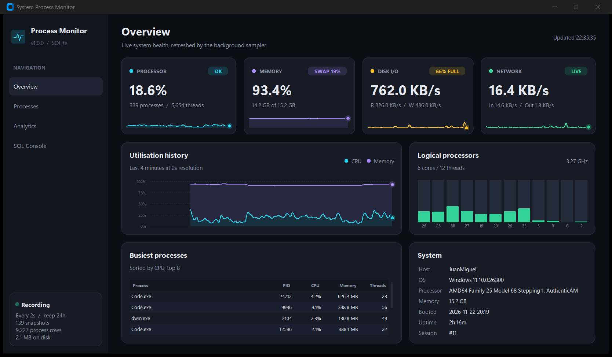
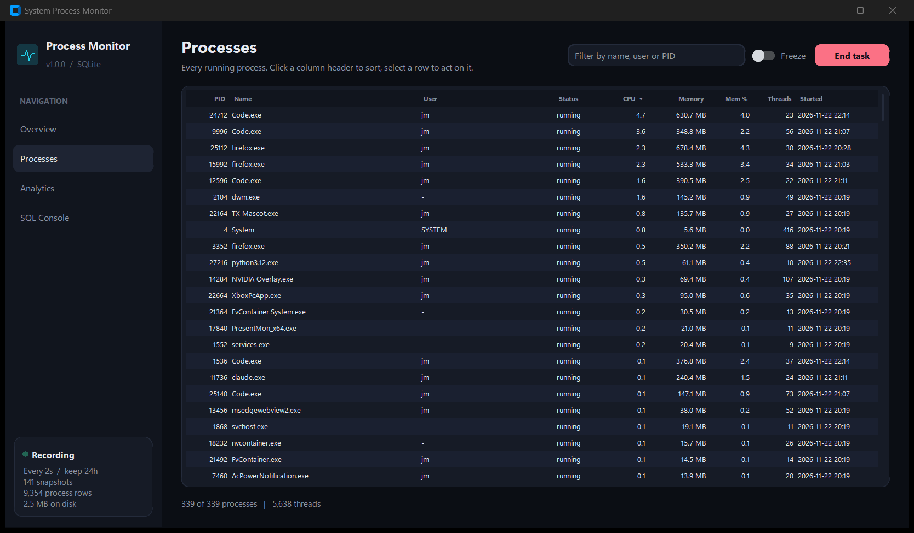
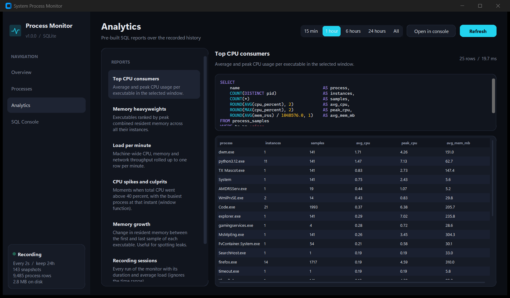
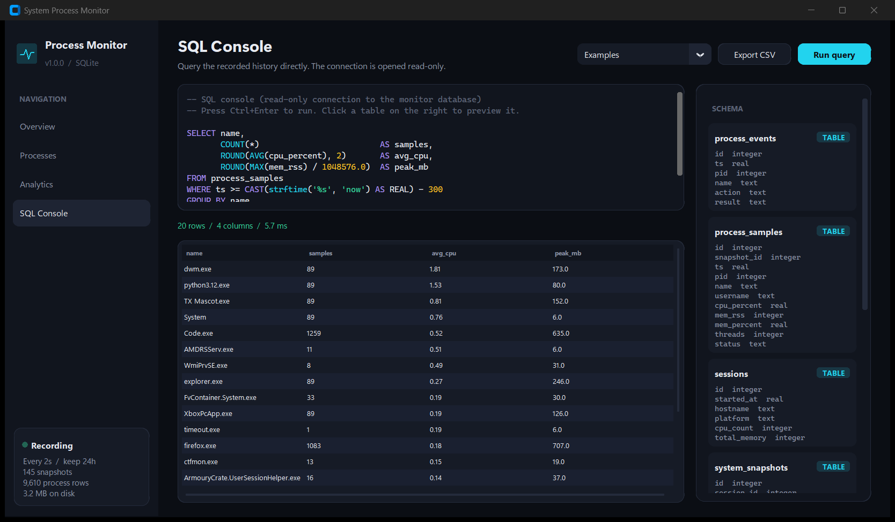
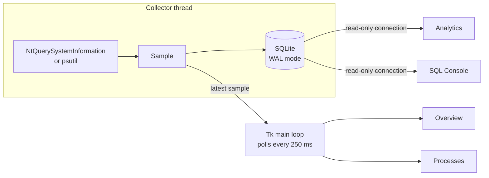
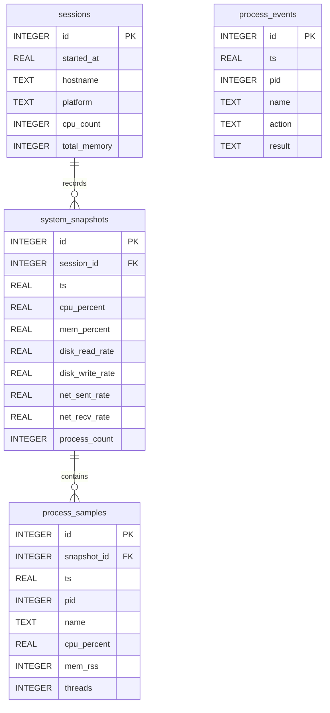

<div align="center">

# System Process Monitor

**A modern desktop process monitor that records everything it sees into SQLite, then lets you interrogate that history with real SQL.**

[](https://www.python.org/)
[](https://www.sqlite.org/)
[](https://github.com/TomSchimansky/CustomTkinter)
[](https://github.com/giampaolo/psutil)

[](#requirements)
[](#changelog)
[](LICENSE)
[](sql/reports.sql)
[](#running-the-tests)
[](https://peps.python.org/pep-0008/)

<br>



</div>

---

## Table of contents

- [Why](#why)
- [Features](#features)
- [Screenshots](#screenshots)
- [Quick start](#quick-start)
- [Command-line options](#command-line-options)
- [How it works](#how-it-works)
- [Database schema](#database-schema)
- [Built-in SQL reports](#built-in-sql-reports)
- [Writing your own queries](#writing-your-own-queries)
- [Project structure](#project-structure)
- [Running the tests](#running-the-tests)
- [Performance notes](#performance-notes)
- [Troubleshooting](#troubleshooting)
- [Changelog](#changelog)
- [License](#license)

---

## Why

Task Manager tells you what is happening **right now**. It cannot tell you which process
spiked the CPU twenty minutes ago, which one has been slowly leaking memory all afternoon,
or what the machine looked like during the last hour of a build.

System Process Monitor samples the whole machine every couple of seconds, keeps a rolling
history in a local SQLite database, and gives you both a polished live dashboard and a
full SQL console to answer those questions yourself.

## Features

| Area | What you get |
| --- | --- |
| **Live overview** | CPU, memory, disk I/O and network cards with sparklines, a 4-minute utilisation chart, per-core load bars, busiest processes and system facts. |
| **Process explorer** | Every running process with PID, user, CPU, memory, threads and start time. Click-to-sort columns, instant filter, a freeze switch and **End task** (with confirmation and an audit trail). |
| **Persistent history** | Machine-wide snapshots plus the heaviest processes per tick are written to SQLite in WAL mode, with automatic retention pruning. |
| **Analytics** | Seven pre-built reports (top CPU, memory heavyweights, per-minute load, CPU spikes with culprits, memory growth, sessions, audit log) over a selectable time window. |
| **SQL console** | Syntax-highlighted editor, schema browser, example library, CSV export. The connection is opened **read-only**, and runaway queries are cancelled after 8 seconds. |
| **Fast on Windows** | Process data comes from a single `NtQuerySystemInformation` call, the same source Task Manager uses, instead of opening every process one by one. |
| **Restart friendly** | The dashboard charts are pre-filled from the database, so restarting the app does not leave you staring at empty graphs. |

## Screenshots

<table>
  <tr>
    <td width="50%"><p align="center"><sub><b>Processes</b>: sortable, filterable, with End task</sub></p></td>
    <td width="50%"><p align="center"><sub><b>Analytics</b>: SQL reports over a time window</sub></p></td>
  </tr>
  <tr>
    <td width="50%"><p align="center"><sub><b>SQL Console</b>: read-only, highlighted, exportable</sub></p></td>
    <td width="50%"><p align="center"><sub><b>Overview</b>: live health at a glance</sub></p></td>
  </tr>
</table>

## Quick start

### Requirements

- Python **3.9 or newer** with Tk (included in the standard Windows and macOS installers; on Debian/Ubuntu install `python3-tk`)
- Windows 10/11 is the primary target. Linux and macOS work through the generic psutil code path.

### Windows, one click

Double-click **`run.bat`**. It installs the two dependencies on first launch and starts the app.

### Any platform, manually

```bash
git clone <your-fork-url> SystemProcessMonitor
cd SystemProcessMonitor

python -m venv .venv
# Windows:      .venv\Scripts\activate
# Linux/macOS:  source .venv/bin/activate

pip install -r requirements.txt
python main.py
```

The database is created on first run at `data/monitor.db`.

## Command-line options

```text
python main.py [--interval SECONDS] [--db PATH] [--retention HOURS] [--top N]
```

| Option | Default | Description |
| --- | --- | --- |
| `--interval` | `2` | Sampling interval in seconds (minimum `0.5`). |
| `--db` | `data/monitor.db` | Location of the SQLite database file. |
| `--retention` | `24` | Hours of history to keep. Older rows are pruned at startup and every 300 ticks. |
| `--top` | `40` | Processes persisted per snapshot: the top N by CPU, merged with the top N by memory. |

Example: sample every second and keep a full week of data.

```bash
python main.py --interval 1 --retention 168
```

## How it works



- A **daemon collector thread** owns its own writable SQLite connection. Every tick it reads
  machine-wide metrics, enumerates processes, inserts one `system_snapshots` row and a batch
  of `process_samples` rows inside a single transaction, then publishes the sample behind a lock.
- The **UI thread never blocks on sampling**. It polls the latest sample and updates only the
  visible page; the process table is updated incrementally, so selection and scroll position survive refreshes.
- **WAL journaling** lets the collector write while the Analytics view and the SQL console read concurrently.
- The SQL console uses a connection opened with `mode=ro`, so even a stray `DELETE` cannot touch your data.

## Database schema



Two convenience views ship with the schema:

| View | Purpose |
| --- | --- |
| `v_process_stats` | All-time average/peak CPU and memory per executable, with first and last seen times. |
| `v_system_minutely` | Machine load rolled up to one row per minute. |

The full DDL lives in [`sql/schema.sql`](sql/schema.sql). Timestamps are Unix epoch seconds (`REAL`);
use `datetime(ts, 'unixepoch', 'localtime')` to make them readable.

## Built-in SQL reports

All reports live in [`sql/reports.sql`](sql/reports.sql) and are parsed at startup from
`-- name:`, `-- title:` and `-- description:` headers, so adding a report is just adding SQL.

| Report | Technique |
| --- | --- |
| Top CPU consumers | `GROUP BY` with `AVG`, `MAX`, `COUNT(DISTINCT pid)` |
| Memory heavyweights | CTE that sums all instances of an executable per tick before ranking |
| Load per minute | Time bucketing with `CAST(ts / 60 AS INTEGER)` and `strftime` |
| CPU spikes and culprits | `ROW_NUMBER() OVER (PARTITION BY snapshot ORDER BY cpu DESC)` |
| Memory growth | Two CTEs plus a self-join of first and last samples to find leaks |
| Recording sessions | `LEFT JOIN` aggregate over every run of the app |
| Action audit log | Every **End task** attempt and its outcome |

Here is the spike report, which pairs every CPU spike with the process responsible for it:

```sql
WITH ranked AS (
    SELECT s.ts, s.cpu_percent AS system_cpu, p.name, p.pid, p.cpu_percent AS process_cpu,
           ROW_NUMBER() OVER (PARTITION BY s.id ORDER BY p.cpu_percent DESC) AS rn
    FROM system_snapshots AS s
    JOIN process_samples  AS p ON p.snapshot_id = s.id
    WHERE s.ts >= :since AND s.cpu_percent >= 40
)
SELECT datetime(ts, 'unixepoch', 'localtime') AS time,
       ROUND(system_cpu, 1) AS system_cpu, name AS top_process, pid,
       ROUND(process_cpu, 1) AS process_cpu
FROM ranked
WHERE rn = 1
ORDER BY ts DESC;
```

## Writing your own queries

Open **SQL Console**, type a query and press **Ctrl+Enter** (or select part of the text to run only that).
Click any table in the schema browser for a quick preview. A few ideas:

```sql
-- Which apps were open the longest in the last 6 hours?
SELECT name, ROUND((MAX(ts) - MIN(ts)) / 60.0) AS minutes_seen
FROM process_samples
WHERE ts >= CAST(strftime('%s', 'now') AS REAL) - 6 * 3600
GROUP BY name
ORDER BY minutes_seen DESC
LIMIT 15;

-- Hourly CPU profile of the whole recorded history
SELECT strftime('%H:00', ts, 'unixepoch', 'localtime') AS hour,
       ROUND(AVG(cpu_percent), 1) AS avg_cpu
FROM system_snapshots
GROUP BY hour
ORDER BY hour;

-- Is the index being used?
EXPLAIN QUERY PLAN
SELECT * FROM process_samples WHERE name = 'explorer.exe' AND ts > 0;
```

Results can be saved with **Export CSV**. The database is a plain SQLite file, so DB Browser for SQLite,
DBeaver, the `sqlite3` CLI or pandas can open it too.

## Project structure

```text
SystemProcessMonitor/
|-- main.py                 Entry point and CLI arguments
|-- run.bat                 One-click launcher for Windows
|-- requirements.txt
|-- requirements-dev.txt
|-- pytest.ini
|-- tests/                  pytest suite (database, reports, collector, helpers)
|-- sql/
|   |-- schema.sql          Tables, indexes and views (idempotent)
|   `-- reports.sql         Analytics reports with name/title/description headers
|-- spm/
|   |-- app.py              Main window, sidebar, page routing, polling loop
|   |-- collector.py        Background sampler thread
|   |-- winproc.py          ctypes NtQuerySystemInformation process snapshot
|   |-- database.py         SQLite layer: inserts, pruning, reports, safe queries
|   |-- widgets.py          Canvas charts, core bars, cards, themed table, SQL highlighter
|   |-- theme.py            Palette, fonts, formatting helpers
|   `-- views/
|       |-- dashboard.py
|       |-- processes.py
|       |-- analytics.py
|       `-- console.py
|-- docs/screenshots/
`-- data/                   Created at runtime (monitor.db)
```

## Running the tests

```bash
pip install -r requirements-dev.txt
pytest
```

| File | Covers |
| --- | --- |
| `tests/test_database.py` | Schema bootstrap, WAL mode, inserts, retention pruning, read-only enforcement, row limits, query timeout |
| `tests/test_reports.py` | Every report runs on an empty database, and returns the expected answers on a known fixture |
| `tests/test_collector.py` | Process enumeration, CPU accounting, the Windows fast path against psutil, the live collector thread |
| `tests/test_theme.py` | Formatting helpers, colour blending, table sort order, the SQL tokenizer |

The tests use temporary databases and never touch `data/monitor.db`. No window is opened.

## Performance notes

- On Windows, enumerating ~350 processes through per-process `OpenProcess` calls took about **5 seconds**
  on the development machine. Reading one `SystemProcessInformation` snapshot through `ntdll` takes about
  **10 ms**. Per-process CPU percentages are derived from kernel and user time deltas between ticks,
  normalised across all logical cores (0-100 %, like Task Manager).
- Usernames are resolved once per process (keyed by PID and creation time) and cached.
- Only the heaviest processes per tick are persisted (`--top`), which keeps the database at roughly
  1-2 MB per hour at the default settings. Indexes on `ts`, `(name, ts)` and `snapshot_id` keep reports fast.
- Charts are drawn directly on `tk.Canvas`; there is no matplotlib dependency.

## Troubleshooting

| Symptom | Fix |
| --- | --- |
| `ModuleNotFoundError: customtkinter` or `psutil` | Run `pip install -r requirements.txt` with the same interpreter you use to start the app. |
| **End task** says "access denied" | System and service processes need elevated rights. Start the terminal or `run.bat` as administrator. |
| Text looks blurry on a high-DPI screen | Make sure you are using the regular `python.exe`, not a compatibility-mode shortcut. CustomTkinter enables per-monitor DPI awareness automatically. |
| "database is locked" | Two instances share one database file. Close one of them or start the second with `--db other.db`. |

## Changelog

### 1.0.0
- First release: live overview, process explorer, SQLite history, seven analytics reports,
  read-only SQL console with highlighting and CSV export, fast Windows process enumeration.

## License

Released under the [MIT License](LICENSE).
